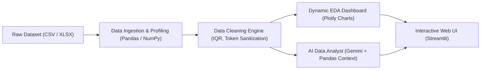

<div align="center">

# 📊 DataPilot: AI-Assisted Data Analytics Platform

[](https://datapilot-ai-analytics.streamlit.app/AI_Analyst)
[](https://www.python.org/)
[](https://ai.google.dev/)
[](https://plotly.com/)
[](LICENSE)

**An intelligent end-to-end data exploration, profiling, cleaning, and analytics platform powered by Python, Streamlit, and Google Gemini AI.**

🚀 **Live Demo:** [datapilot-ai-analytics.streamlit.app/AI_Analyst](https://datapilot-ai-analytics.streamlit.app/AI_Analyst)

[Key Features](#-key-features) • [Architecture](#-architecture) • [Getting Started](#-getting-started) • [Tech Stack](#-tech-stack) • [Project Structure](#-project-structure)

---

</div>

## 🌟 Overview

Data analysis usually requires writing repetitive scripts, switching between disjointed spreadsheets, and manual chart configuration. **DataPilot** unifies this workflow into a single, intuitive web interface designed for both non-technical business users and data professionals.

Unlike traditional static dashboards, DataPilot is **context-aware**:
1. **Python & Pandas** execute all numerical calculations, aggregations, and data manipulations locally with 100% precision.
2. **Google Gemini AI** assists with intelligent dashboard planning, key trend interpretation, and natural language query explanations.

---

## 🚀 Key Features

### 1. 📂 Universal Dataset Ingestion
- Upload structured datasets in **CSV** or **Excel (.xlsx, .xls)** formats.
- Instant dataset preview, row/column statistics, and memory usage profiling.

### 2. 🔍 Automated Data Profiling
- Comprehensive health checks: column data types, missing value percentages, and duplicate row detection.
- Statistical distributions and unique cardinality summaries for every attribute.

### 3. 🧹 Robust & Interactive Data Cleaning
- **Placeholder Detection:** Automatically flags masked missing tokens (`"?"`, `"-"`, `"N/A"`, `"null"`).
- **Text Standardization:** Strips leading/trailing whitespace, handles inconsistent casing, and fixes category spelling variations.
- **Type Validation & Loss Prevention:** Safely converts string columns to numeric with safety thresholds to prevent data loss.
- **Outlier Tagging:** Identifies extreme values using the Interquartile Range (IQR) rule.
- **Export Clean Data:** Download cleaned datasets directly as standard CSV or Excel files.

### 4. 📈 AI-Powered Dynamic EDA Dashboard
- Dynamic KPI metric cards (totals, averages, completion rates).
- Auto-generated interactive **Plotly** visualizations:
  - Categorical breakdowns and adoption rankings.
  - Multi-series temporal trends and seasonal patterns.
  - Periodic volume distributions and domain correlations.
- Filter slices across key attributes with automatic chart updates.
- AI-synthesized takeaway cards highlighting concentration, growth drivers, and seasonality.

### 5. 🤖 Conversational AI Data Analyst
- Ask questions about your dataset in plain English (e.g., *"Which categories have the highest completion rate?"* or *"What are the biggest anomalies?"*).
- **Grounded Responses:** Gemini combines the dataset's structural summary with pandas-calculated metrics, ensuring answers are factual and hallucination-free.

---

## 🏗️ Architecture



---

## 🛠️ Tech Stack

| Technology | Purpose |
| :--- | :--- |
| **Python** | Core backend processing language |
| **Streamlit** | Interactive modern web framework & multi-page navigation |
| **Pandas & NumPy** | Fast in-memory data transformation, statistics, and calculations |
| **Plotly** | Responsive, interactive data visualizations and charts |
| **Google Gemini API** | Contextual dashboard layout planning and conversational insights |
| **OpenPyXL** | Native Excel (.xlsx) file parsing and generation |
| **Scikit-learn** | Statistical utilities and machine learning data helpers |

---

## 💻 Getting Started

### Prerequisites
- Python 3.10+ installed on your system.
- A free [Google AI Studio API Key](https://aistudio.google.com/).

### Local Installation

1. **Clone the repository:**
   ```bash
   git clone https://github.com/mohit-dhoundiyal/DataPilot.git
   cd DataPilot
   ```

2. **Create and activate a virtual environment:**
   ```bash
   # Windows (PowerShell)
   python -m venv .venv
   .venv\Scripts\Activate.ps1

   # macOS / Linux
   python3 -m venv .venv
   source .venv/bin/activate
   ```

3. **Install dependencies:**
   ```bash
   pip install -r requirements.txt
   ```

4. **Configure your Gemini API key:**
   Create a file at `.streamlit/secrets.toml`:
   ```toml
   GEMINI_API_KEY = "your-google-gemini-api-key"
   GEMINI_MODEL = "gemini-3.5-flash-lite"
   ```

5. **Run the application:**
   ```bash
   streamlit run App.py
   ```
   Open your browser at `http://localhost:8501`.

---

## 📁 Project Structure

```text
DataPilot/
├── .streamlit/
│   ├── config.toml             # Streamlit visual theme configuration
│   └── secrets.toml            # Private API keys (git-ignored)
├── ai/
│   └── dashboard_insights.py   # Gemini prompt construction & analytical summaries
├── engine/
│   ├── cleaner.py              # Interactive data cleaning & transformation logic
│   ├── dashboard_planner.py    # Metric selection & visualization layout engine
│   ├── eda.py                  # Exploratory data analysis calculation routines
│   ├── loader.py               # Safe CSV and Excel file ingestion
│   └── profiler.py             # Schema, quality, and statistical profiling
├── pages/
│   ├── 1_Data_Profile.py       # Data Profiling & Schema Inspection UI
│   ├── 2_Data_Cleaning.py      # Multi-rule Interactive Cleaning UI
│   ├── 3_EDA_Dashboard.py      # Plotly EDA Dashboard & KPI Visualizer UI
│   └── 4_AI_Analyst.py         # Conversational Gemini Data Analyst UI
├── utils/
│   ├── __init__.py             # Module initialization
│   └── ui_styles.py            # Global responsive CSS styling & badges
├── .gitignore                  # Git tracking exclusion rules
├── App.py                      # Main landing page & application entry point
├── README.md                   # Project documentation
└── requirements.txt            # Python dependencies
```

---

## 🔒 Security & Privacy

* **Strict Grounding:** Gemini only receives column summaries, data types, and calculated statistical aggregates. Full raw datasets are never uploaded to external LLM servers.
* **Secret Protection:** All API credentials are read securely via `st.secrets` and excluded from git version control.

---

## 👤 Author

**Mohit Dhoundiyal**
* Department of Artificial Intelligence & Data Science
* Dr. Akhilesh Das Gupta Institute of Professional Studies (ADGIPS), GGSIPU, Delhi
* GitHub: [@mohit-dhoundiyal](https://github.com/mohit-dhoundiyal)
* Email: `mohitdhoundiyal2005@gmail.com`

---

## 📄 License

This project is licensed under the [MIT License](LICENSE).
